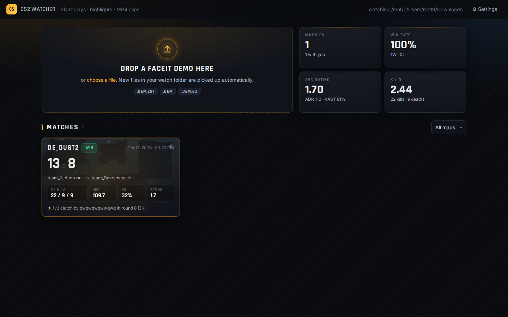
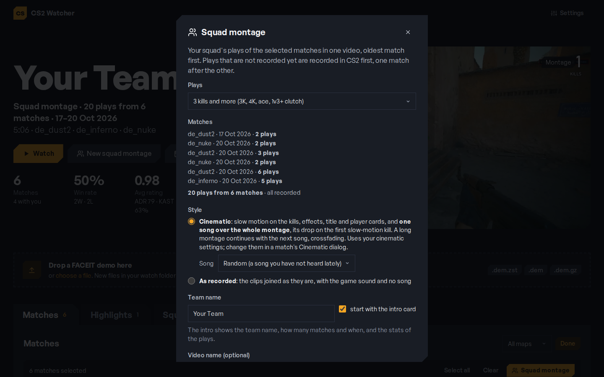
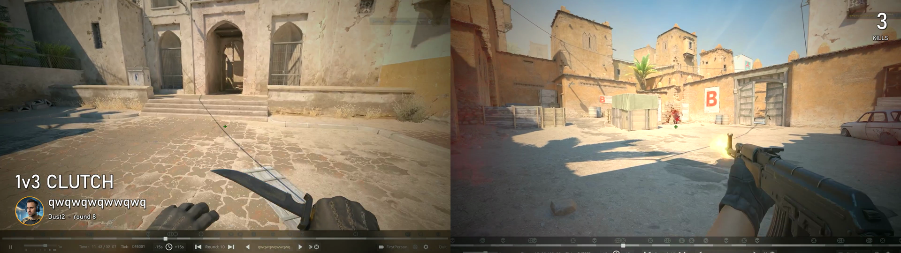
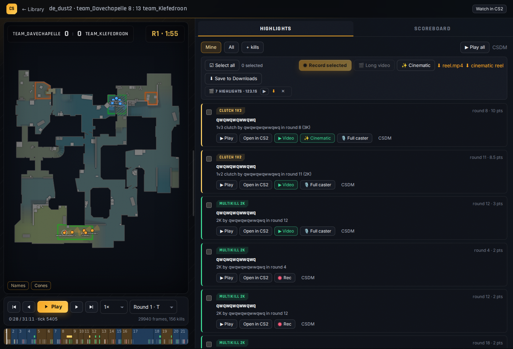
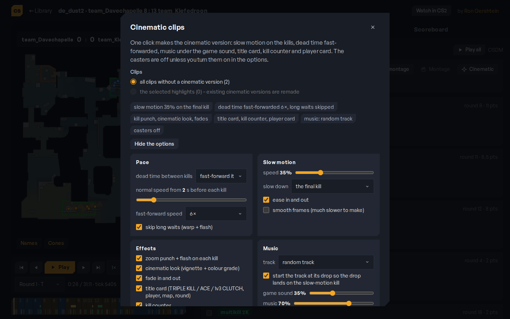
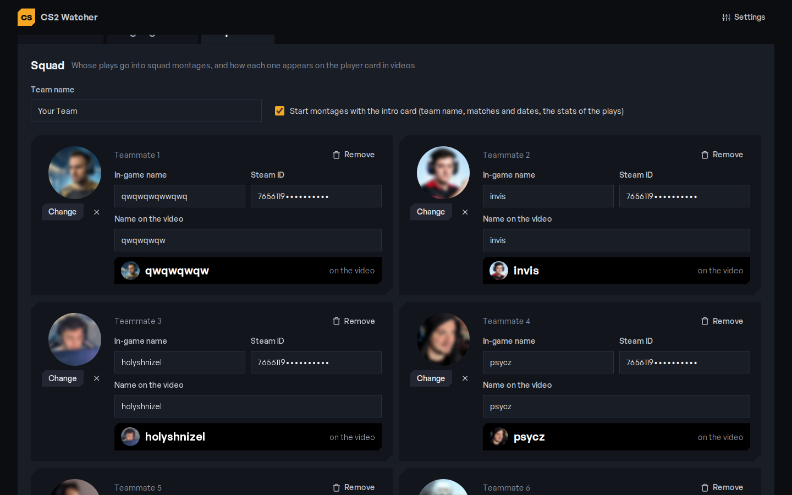

# CS2 FACEIT Highlighter

Created by **[Ron Gershtein](https://github.com/RonGershtein)**.

Drop a FACEIT (or Valve MM) CS2 demo into a local web app and get:

- a **2D top-down replay** in the browser (players, view cones, HP, smokes, molotovs, grenades, bomb, kill lines)
- **automatic highlights**: multi-kills, aces, clutches, ninja defuses, knife kills, with a "mine" filter
- per-match **stats** (K/D/A, ADR, HS%, KAST, rating) and a library of all your matches
- **Open in CS2** at any highlight, or watch the whole demo in the game
- **MP4 recording** of selected highlights (CS2 + HLAE + FFmpeg, first-person, with game audio), a **long video** from any clips you pick,
  and a **cinematic** version: slow motion on the kills, dead time fast-forwarded (long waits warped through and cut), your own music
  started at its drop, zoom punch and flash on kills, title card ("TRIPLE KILL", "ACE", "1v3 CLUTCH"), kill counter, caster voice lines
  and a **player card** with your friend's photo
- **Squad montages**: pick any matches and get your squad's 3K+ plays in one cinematic video with one song, recorded in a single CS2
  session; and a **monthly / yearly recap** of everything you recorded

Everything runs on your PC. Nothing is uploaded anywhere.








## Requirements

| | |
|---|---|
| OS | Windows 10/11 for the full feature set (CS2 launching and recording). The replay viewer and highlights also work on Linux/macOS. |
| Python | 3.11 or 3.12. `start.bat` offers to install it for you (via winget) if it is missing; or get it from [python.org](https://www.python.org/downloads/) and tick **"Add python.exe to PATH"**. |
| CS2 | installed through Steam (only needed for "Open in CS2" and recording) |
| Disk | ~250 MB per demo kept by the app, plus ~35 MB per recorded 20 s clip |

HLAE and FFmpeg are downloaded by the app itself when you first click **Install HLAE + FFmpeg** (about 100 MB).

## Install and run (Windows)

1. Download this repository: **Code → Download ZIP** and unzip it, or `git clone https://github.com/RonGershtein/Cs2-faceit-highlighter`.
   Put it in a folder **without spaces** in the path, for example `C:\cs2-highlighter`.
   It must be a normal Windows folder, not a network or WSL path (`\\wsl.localhost\...`).
2. Double-click **`start.bat`**.
   The first run creates a Python environment, installs the dependencies, downloads the radar images (1–3 minutes)
   and puts a **CS2 Highlighter** icon on your Desktop.
3. Your browser opens at **http://localhost:8000**. From now on just double-click the Desktop icon to start the app;
   close its (minimized) console window to stop it.

### Commands

Everything can also be done from a terminal. `make` on Linux/macOS/WSL, `cs2w.bat` on Windows (same commands):

| command | what it does |
|---|---|
| `make install` / `cs2w install` | create the Python env, install dependencies, download radars |
| `make run` / `cs2w run` | start the app |
| `make doctor` / `cs2w doctor` | check Python, dependencies, config, CS2 path, HLAE/FFmpeg, disk |
| `make tools` / `cs2w tools` | download HLAE + FFmpeg for recording (same as the button in the app) |
| `make test` / `cs2w test` | run the unit tests |
| `make parse DEMO=x.dem.zst` / `cs2w parse x.dem.zst` | parse one demo from the CLI |
| `make shortcut` / `cs2w shortcut` | (re)create the Desktop icon |
| `make update` / `cs2w update` | `git pull` + reinstall dependencies |
| `make clean` / `cs2w clean` | remove the Python env (keeps your data) |

### First-time setup (2 minutes)

1. Click **⚙ Settings** (top right).
2. **Demo download folder**: click **Browse…** and pick the folder your browser saves FACEIT demos to (usually `Downloads`).
   Every new demo that lands there is parsed automatically.
3. **Save clips to**: where recorded videos are copied. Leave empty for `Downloads\cs2-watcher`.
4. Save. Drop your first demo on the big drop area (or just download one from FACEIT).
5. Open the match. The app asks **"Who are you in this match?"** — click your name. From then on, "Mine" filters show your highlights and the library shows your stats.

## Using it

### Library
Match cards show the score from your side, win/loss, your K/D/A, ADR, HS% and rating, and the top highlight. Click a card to open the viewer. Hover a card and click ✕ to remove a match from the app (your original download is kept, and its recorded clips stay in the Highlights tab).

### Squad montage
"👥 Squad montage" on a match collects every play of 3+ kills (3K, 4K, ace, a clutch with 3+ kills) by you and your
friends, records the ones that are not recorded yet (CS2 opens and closes by itself), makes them cinematic (or keeps
them as recorded, your choice) and joins them in match order. A cinematic squad montage has one song over the whole
video instead of a new song per play: each play is rendered without music, then the song (the chosen track or a random
one) is laid over everything, its drop on the first slow-motion kill, dipping under caster lines. "⚙ Cinematic
settings" opens the usual Cinematic dialog for this montage. Caster lines are only used when ticked for that run: the
tick is never remembered, so anything made without opening the settings has no casters. The squad
list (nickname + optional Steam64 ID; without an ID the in-game name is matched) is saved in `data/squad.json`.
The result is a long video of that match: it appears in the Highlights tab, where several squad montages can be joined.

All kills of a player in one round count as one play (two kills, then two more half a minute later, is a 4K); the
cinematic pace fast-forwards the quiet part in between. A cinematic job keeps running when you open another match,
and jobs started meanwhile wait in a queue.

**Several matches at once:** in the library, **Select matches**, click the matches (or **Select all**), then
**Squad montage** → **Create squad montage** (or **New squad montage** at the top). The squad's
plays of all of them become one video with the intro card (team name, dates, stats) and one soundtrack (the next
songs crossfade in when the video is longer; every song plays only its loud parts: the quiet intro, the outro and
any quiet stretch of 8 s or more inside it are cut, crossfading). Plays that are not recorded yet are recorded first in one CS2 session that loads demo after demo. While CS2
records, the plays already recorded are rendered in the background at low priority, so when the game closes most of
the montage is done. Rendered plays are kept (see `render_cache_gb`), so a second montage or a recap with the same
plays only joins them.

**Order: best fit to the song** (the default; `montage_order` in `config.toml`): the plays are not joined in match
order but in the order that puts the most slow-motion kills exactly on the drops of the soundtrack, the biggest plays
(aces, 4Ks, clutches) on the biggest drops and a big play last. The app measures every drop of every song that will
play, tries the strongest plays as the opener and searches the orders of the rest (each play can also start a little
earlier or later). On a 20-play montage that is 18 kills on a drop instead of 5 in match order. Pick **match order** in
the dialog for a chronological video. A montage you put together by hand in the Highlights tab keeps your order.

**Recap:** the **Recap** button makes one video of every recorded squad play in a month, a year or any date range.

**Squad tab:** the friends whose plays count, their Steam64 IDs and their photos for the player card. Upload a photo
there; it is cropped to a round avatar in the videos.

If the app is closed (or loses track of the game) while CS2 is still recording, nothing is lost: the next time it
starts, or opens that match, it turns what CS2 recorded into clips by itself.

### Highlights tab
Every video you made, from every match: original clips, cinematic versions, long videos and montages, newest first.
They stay here after you delete the match (the map, date and score are saved with the clips). Filter by kind or map,
hover a clip for a muted preview, click to watch, ⬇ to download, ✕ to delete (deleting an original also deletes its
cinematic version; deleting only the cinematic version keeps the original).

**Select / montage:** click "☑ Select" (or just drag a clip onto the page bottom), pick clips from any matches; the tray
at the bottom lists them in play order (drag the rows or use ↑↓). "🗑 Delete" removes all selected videos at once;
"🎬 Create montage" joins them, with an optional name. Clips of the same kind are joined
instantly; a mix of original and cinematic clips is re-encoded to one size and frame rate. Montages are kept in
`data/videos/montages/` and copied to `<save clips folder>/montages/`.

### Viewer
- **Play / pause**: `space`. `←` `→` seek 5 s, `,` `.` one frame, `[` `]` previous/next kill, `PgUp` `PgDn` previous/next round, `L` toggles the lower level on Nuke/Vertigo/Train.
- Click the timeline to jump. Rounds are colored by the winning side; marks are kills, bars are highlights.
- **Highlights** tab: click **▶ Play** to watch the moment in 2D. **Open in CS2** starts the game with the demo; when it has loaded, open the console (`` ` ``) and type `exec hl` to jump to the highlight spectating the player.
- **Watch in CS2** (top bar) opens the whole demo from round one.
- The handle between the map and the panel can be dragged to resize the panel.

### Recording highlights to MP4
1. Click **Install HLAE + FFmpeg** once (in the Highlights panel). HLAE is the tool every CS movie maker uses; it is only used for demo playback.
2. Tick the highlights you want (or **Select all**) and click **Record N selected**.
3. Read the checklist: **close CS2 and the FACEIT client** first. Click **Start recording**.
4. CS2 opens in a window and records the clips one by one in your first-person view, then closes itself.
   Budget about a minute per highlight. Don't touch the game meanwhile.
5. Each card gets a **▶ Video** button. Clips are in the app and copied to your clips folder.
6. **Long video from your picks:** tick two or more highlights that already have a clip and press **🎬 Long video**. Their clips are
   joined in match order into one MP4 (optionally using the cinematic versions), listed under the toolbar with ▶ / ⬇ / ✕, and copied to your clips folder.
7. **Delete clips:** tick recorded highlights and press **🗑 Delete clips**. The clip (and its cinematic version) is removed from the app;
   a checkbox also removes the copies in your clips folder. The highlight can be recorded again afterwards.

CS2 runs with `-insecure` while recording, which only disables VAC for that session. When you want to play, start CS2 normally from Steam as usual.

### Cinematic clips
Click **✨ Cinematic**. The dialog has every option, remembers them, and processes either all clips without a cinematic version or the
highlights you ticked (those are remade). Takes ~10-20 s per clip
(much longer with "smooth frames").

- **Pace:** dead time between kills (walking, waiting) is fast-forwarded at 6x by default, or cut out, with normal speed from
  2 s before each kill. Nothing is re-recorded; the clip's kill ticks from the demo decide where the action is.
- **Skip long waits** (on by default): a wait that would still drag on fast-forwarded (a 100 s rotation is 17 s at 6x)
  keeps only a warp into it and out of it, speeding up to 16x, with a quick white flash where the middle is cut. A 113 s
  clutch becomes a 16 s clip instead of 30 s.
- **Slow motion** on the final kill or every kill, with a speed ramp in and out.
- **Effects:** zoom punch and flash on each kill, vignette and colour grade, fade in/out.
- **Text:** a title card for the first seconds (TRIPLE KILL / ACE / 1v3 CLUTCH, then "3K · map · round") and a kill counter.
  Uses Bahnschrift or Arial from Windows; drop any `.ttf` into `assets/fonts/` to use that instead.
- **Player card:** a round avatar with the player's nickname at the bottom left, like a pro-match lower third. It stays on screen for the whole clip. Photos go in
  `data/players/<steam64>.png` (or .jpg); without one a blank circle with the initial is shown. Optional `data/players.json`
  (`{"<steam64>": {"name": "nickname", "photo": "file.png"}}`) overrides the in-game name.
- **Music:** add MP3/M4A/WAV files (royalty-free if you plan to publish). A random track or the one you pick plays under the game sound.
  With "start the track at its drop" the app measures the track's loudness, finds the biggest sustained rise (the drop) and starts the
  music so the drop lands exactly on the slow-motion kill.
- **Caster voice lines:** short sound bites in `data/voice/start`, `data/voice/kill` and `data/voice/final` play at the clip start, on
  every kill but the last, and right after the final kill. They are picked by what happened: a sub-folder named after the highlight type
  (`ace`, `clutch`, `multikill`, `knife`, `ninja_defuse`) or, for the kill slot, the kill number (`2`, `3`, `4`, `5`) wins when it has
  files, otherwise a general line from the slot plays. Click a line in the dialog to pin it: a slot with pinned lines only uses those.
  The lines are real caster recordings: upload your own clips, and the "new lines are for" selector puts them in the right
  folder. Untick "play caster voice lines" for a clean clip. The clip runs on until the last
  line has finished.

### Sharing a video
Every video player has a **Share** button:
1. **Open YouTube upload** and **Show the file** (Explorer opens with the video selected): drag it onto the page and
   choose **Unlisted**, so only people with the link can watch. A title and a description (the list of plays) are
   ready to copy.
2. Paste the link YouTube gives you; the app keeps it with the video.
3. **Email it to me** sends the link to your Gmail, **Send on WhatsApp** opens WhatsApp with the message ready, or
   **Copy link**.

The upload is the one manual step on purpose: YouTube keeps videos uploaded by personal apps through its API private
until Google audits the app, so "anyone with the link" only works when you upload yourself. For the email, put your
Gmail address and a Gmail [app password](https://myaccount.google.com/apppasswords) (needs 2-step verification) in
Settings; both stay in `config.toml` on your PC.

### Storage
**Settings → Storage** lists every place the app keeps files and how big it is. **Clear** empties the ones that lose
nothing for good: the copies in your clips folder (only files the app named, in the folders it made), the cache of
rendered montage plays, the demo copies in the CS2 folder and leftover raw recordings. It waits while CS2 is open or
something is recording or rendering. Clips and montages are deleted in the Highlights tab, matches with their ✕.

### Config file
`config.toml` is created next to `start.bat` on first run. Most of it is editable from Settings; the rest:

| key | default | meaning |
|---|---|---|
| `tick_step` | 4 | keep every N-th tick for the 2D replay (4 = 16 fps) |
| `record_width` / `record_height` / `record_fps` | 1920 / 1080 / 60 | recording resolution and frame rate |
| `record_crf` | 20 | x264 quality, lower = better and bigger |
| `record_close_game` | true | quit CS2 after the last clip |
| `record_hud` | killfeed | `killfeed`: a clean picture with the kill feed only; `health_ammo`: CS2's HUD with health and ammo |
| `record_encoder` | x264 | `amf` records with an AMD graphics card's encoder instead of the CPU (try it if recording is slow) |
| `record_fast_preroll` | false | play the unrecorded 2 s before each highlight at 4x |
| `montage_order` | song | `song`: squad montages and recaps put the plays in the order that fits the song's drops; `date`: match order |
| `render_parallel` | 3 | montage plays rendered at the same time |
| `render_while_recording` | true | render the plays already recorded while CS2 records the rest |
| `render_cache_gb` | 20 | rendered montage plays kept for the next montage or recap (oldest go first) |
| `cine_*` | | every option of the Cinematic dialog (slow motion, pace, effects, text, music, voice); the dialog writes them |

Restart the app after editing the file by hand.

## Troubleshooting

- **The page says "API.… is not a function" or looks broken after an update**: hard refresh with `Ctrl+F5`.
- **"Open in CS2" opens the game at round one**: that is expected, type `exec hl` in the console to jump.
- **Recording: CS2 opens and sits in the menu / nothing recorded**: close the FACEIT client, make sure CS2 was fully closed before starting, then try again. If the demo plays but nothing happens, open the console and type `exec cs2watcher_rec`.
- **Recording: no audio in the clip**: update to the latest version of this repo (fixed) and re-record.
- **Recording is slow**: every match folder in `data/videos/` gets a `record_timing.json` with how fast each clip recorded
  (`speed` 1.4 = 1.4 s of game per second). If your CPU is maxed out while recording and you have an AMD card, try
  `record_encoder = "amf"`.
- **CS2 kept recording after the app said it was done**: restart the app; it makes clips of whatever CS2 recorded meanwhile.
- **A demo stays at "parsing"**: look at the console window for the error; remove the match and drop it again.
- **Python not found**: answer `Y` when `start.bat` offers to install it, or install Python 3.11/3.12 from python.org with "Add to PATH" ticked, then run `start.bat` again.
- **"This folder is on a network path"**: the repo lives in WSL or on a share. Clone or copy it to a Windows folder such as `C:\cs2-highlighter` and start it from there.
- **Something else is off**: run `cs2w doctor` (or `make doctor`); it lists what is missing and how to fix it.

## Safety

HLAE and `-insecure` are the standard, long-established way of recording CS demos (CS Demo Manager works the same way). They are never used on live servers and the game refuses VAC-secured servers while in that mode. Keep the FACEIT client closed while recording.

## Development

```
python -m venv .venv && .venv/Scripts/pip install -r requirements.txt    # or .venv/bin on Linux
python scripts/fetch_radars.py
python run.py                       # http://localhost:8000
pytest tests/test_highlights.py tests/test_record.py
CS2_SAMPLE_DEMO=path/to/match.dem.zst pytest tests/test_parse.py
python -m backend.ingest path/to/match.dem.zst   # parse one demo from the CLI
```

```
run.py / start.bat       start the server (+ browser); cs2w.bat and Makefile wrap the common commands
scripts/doctor.py        environment check; scripts/fetch_tools.py downloads HLAE + FFmpeg; scripts/make_shortcut.ps1 Desktop icon
backend/app.py           FastAPI routes, static frontend
backend/ingest.py        decompress → parse → artifacts → highlights → sqlite; watch folder
backend/parser.py        demoparser2: rounds, sampled frames, kills, grenades, stats
backend/highlights.py    highlight rules (unit tested)
backend/maps.py          radar calibration (from CS Demo Manager) and world→radar transform
backend/launch.py        open CS2 at a tick
backend/record.py        HLAE + FFmpeg recording pipeline
backend/cinematic.py     slow-motion + music post-processing
frontend/                index.html (library), match.html (viewer), js/replay.js (canvas renderer)
data/                    demos, parsed matches, videos, music, app.db   (not in git)
tools/                   HLAE and FFmpeg                                (downloaded, not in git)
```

Parsing happens on your PC, so hosting this on a serverless platform is not an option; a VPS or a static viewer fed with the parsed JSON would be.

## Credits

- [demoparser2](https://github.com/LaihoE/demoparser) for parsing
- [HLAE](https://github.com/advancedfx/advancedfx) and [FFmpeg](https://ffmpeg.org) ([BtbN builds](https://github.com/BtbN/FFmpeg-Builds)) for recording
- radar images and calibration from [CS Demo Manager](https://github.com/akiver/cs-demo-manager), whose recording approach this project follows

## License

MIT
